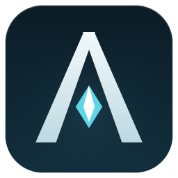
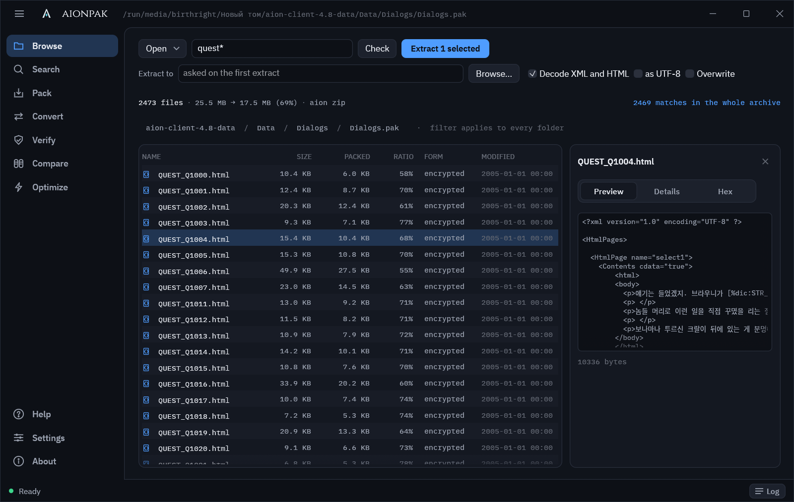
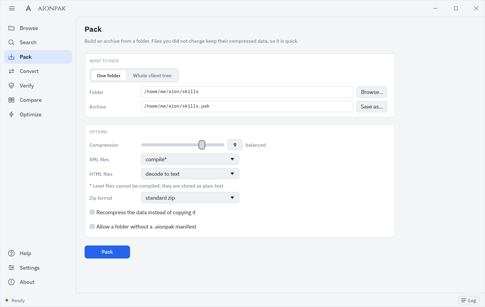

<div align="center">



# Aion Pak

**Open, extract, edit and repack the `.pak` archives of the Aion client.**

[](LICENSE)


**Download:** [Windows (aionpak.exe)](https://github.com/beyond-aion/aion-pak/releases/latest/download/aionpak.exe) ·
[Linux (aionpak-linux)](https://github.com/beyond-aion/aion-pak/releases/latest/download/aionpak-linux) ·
[all files](https://github.com/beyond-aion/aion-pak/releases/latest)



</div>

Aion Pak unpacks and repacks the `.pak` archives of the Aion client, in place of pak2zip and AION Encdec. It
decrypts and decodes the client's XML and HTML into plain text you can edit, and packs your changes back.
Tested with 4.6, 4.8 and 4.9 clients.

- **Browse** an archive and preview its text, XML, textures, sounds, 3D models and fonts.
- **Extract** one archive or the whole client, with XML and HTML as readable text.
- **Pack your changes back.** Files you did not touch are copied as they were, so the game sees the same
  archive apart from your edits.
- **Check and compare** archives, or two whole clients.
- **Speed up the game's start** by merging the archives it loads into a few large ones.

## Getting started

1. Download [`aionpak.exe`](https://github.com/beyond-aion/aion-pak/releases/latest/download/aionpak.exe) on
   Windows or [`aionpak-linux`](https://github.com/beyond-aion/aion-pak/releases/latest/download/aionpak-linux)
   on Linux (make it executable with `chmod +x aionpak-linux`). Nothing to install.
2. Start it and drop a `.pak` file, or your client's folder, onto the window.
3. Press **Extract all**. Leave **Decode XML and HTML** on to get readable text.
4. Edit what you need.
5. Open **Pack**, choose the extracted folder and the archive to write, and press **Pack**. If you extracted
   the whole client, choose **Whole client tree** instead.

Keep the small `.aionpak` file that extraction writes next to the files: Pack uses it to rebuild the archive
the same way. The game ignores it.



## Good to know

- **Windows may warn** "Windows protected your PC" on the first start, as the program is not code-signed yet.
  Choose **More info → Run anyway**. You can check the file against `SHA256SUMS.txt` from Releases first.
- **Close the game** before Optimize. Applying it moves the replaced archives to a backup folder, and
  **Undo** puts them back.
- **XML goes back compiled**, the form the game loads fastest. Choose *as in the source archive* to keep each
  file in the form it came in.

## Command line

Give `aionpak` a command and it runs without the window:

```sh
aionpak extract Data/skills/skills.pak -o skills -d     # unpack, XML as text
aionpak pack    skills -o Data/skills/skills.pak        # pack it back
```

The commands are `list`, `extract`, `pack`, `repack`, `decode`, `encode`, `verify`, `compare` and `optimize`;
`aionpak <command> --help` explains each with an example. For servers and scripts, Releases also carry
`aionpak-cli`, the same without the window.

## Building

See [BUILDING.md](BUILDING.md).

## License

GPL-3.0-or-later, see [LICENSE](LICENSE). The bundled fonts (IBM Plex, Cinzel) are under the SIL Open Font
License.
