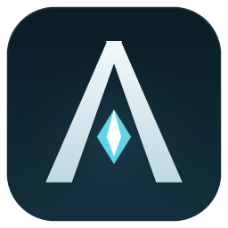
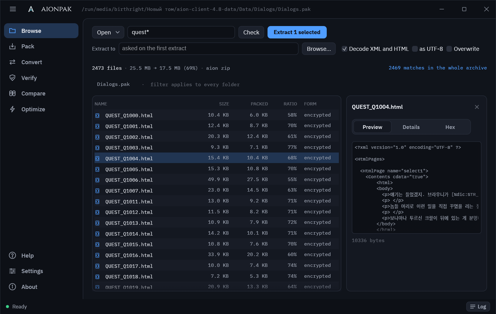
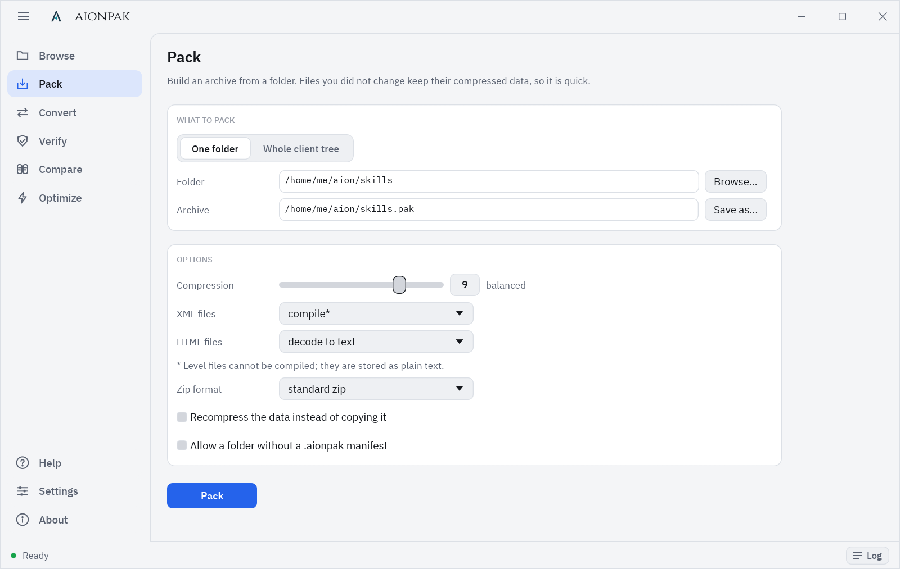

<div align="center">



# Aion Pak

**Open, extract, edit and repack the `.pak` archives of the Aion client.**

[](LICENSE)




</div>

## What you can do with it

- **Look inside** any client archive: names, sizes, how each XML file is stored, and a preview of text, XML,
  textures (DDS included), sounds, 3D models and fonts.
- **Extract** one archive or the whole client, with the client's compiled and encrypted XML turned into
  plain text you can edit in any editor.
- **Pack your changes back.** Files you did not touch keep their original compressed data byte for byte and
  the archive keeps its order, dates and stored forms, so packing is quick and the game sees the same archive
  apart from what you edited.
- **Check** archives the way the game reads them, and **compare** two archives or two clients file by file.
- **Speed up the game's start** by merging the archives it scans into a few large ones.

Everything is available in the desktop app and, with the same options, on the command line.

## Getting started

1. Download the program from [Releases](https://github.com/beyond-aion/aion-pak/releases): `aionpak.exe` on
   Windows, `aionpak-linux` on Linux (make it executable with `chmod +x aionpak-linux`). Nothing to install or
   unpack. You can also [build it yourself](#building).
2. Start it and drop a `.pak` file, or your client's folder, onto the window.
3. Press **Extract all**. Leave **Decode XML and HTML** on to get readable text. The first time, the app asks where to put
   the files.
4. Edit what you need.
5. Open **Pack**, choose the extracted folder and the archive to write, and press **Pack**. If you extracted
   the whole client, choose **Whole client tree** instead: every `<name>.pak/` folder goes back into its
   archive.

Keep the small `.aionpak` file that extraction writes next to the files. It records how the archive was built,
which lets Pack rebuild it the same way and reuse the data of unchanged files. The game ignores it.



## Command line

`aionpak` runs as a command line tool when you give it a command; `aionpak-cli` is the same without the
window, for servers and scripts.

```sh
aionpak list    Data/World/World.pak                    # what is inside
aionpak extract Data/skills/skills.pak -o skills -d     # unpack, XML as text
aionpak pack    skills -o Data/skills/skills.pak        # pack it back
aionpak verify  Data/skills/skills.pak                  # read everything, check every CRC
```

| Command | What it does |
|---|---|
| `list <pak>` | Lists the files in an archive. |
| `extract <pak or folder> -o <out>` | Unpacks one archive, or every archive under a folder. `-d` turns XML into text. |
| `pack <folder> -o <pak>` | Builds an archive from a folder, reusing the data of unchanged files. |
| `repack <tree> -o <client>` | Packs every `<name>.pak/` folder of an extracted client back into its archive. |
| `decode` / `encode <file or folder>` | Converts loose XML and HTML to text and back, without any archive. |
| `verify <pak or folder>` | Reads every file and checks it, as the game does. |
| `compare <a> <b>` | Checks that two archives, or two clients, hold the same files. |
| `optimize <client>` | Merges the archives the game scans at start into a few volumes. |

`aionpak <command> --help` lists every option with an example.

## Good to know

**XML forms.** The client stores XML and HTML in four ways: compiled (binary, the fastest to load), encrypted
(scrambled with a key from the file name, so such a file must not be renamed), UTF-16 text and 8-bit text.
Extracting with Decode XML and HTML gives you text. Pack and Optimize compile XML and store HTML as text by
default, the forms the client loads fastest; level files cannot be compiled and stay text. Convert (`encode`)
compiles XML too and leaves HTML as it is unless you choose UTF-16 text. Choose *as in the source
archive* (`--xml original --html original` on the command line) to put each file back in the form it came in.

**Optimize** can build the volumes into a separate folder, which leaves the client alone, or **Apply** them:
the volumes go into the client and the archives they replace move to a backup folder, which **Undo** puts back.
Close the game before either.

**Windows: SmartScreen and Defender.** The releases are not code-signed yet, so the first start may show
"Windows protected your PC". Check the downloaded file against `SHA256SUMS.txt` before running it.
Microsoft Defender's real-time protection may significantly slow down large extraction operations by scanning
newly created files. The impact depends on the system and Defender's configuration.

**Linux desktop integration.** On start the app adds itself to the application menu with its icon
(`~/.local/share/applications/aionpak.desktop`), because on Wayland the task bar takes the icon from there. If
the task bar still shows a generic icon after the first start, log out and in once.

**Command line only.** The desktop app runs the commands too (`aionpak-linux extract …`). For servers and scripts,
Releases also carry `aionpak-cli.exe`, `aionpak-cli-linux` and `aionpak-cli-linux-static`. The static one needs
no system libraries at all, so it runs on any Linux distribution and in minimal containers; the other uses the
system's glibc and allocator, which take less memory on large jobs.

## Building

You need [Rust](https://rustup.rs) 1.99 or newer and a C compiler (for libdeflate).

```sh
cargo build --release
```

The programs land in `target/release/`.

- **Windows:** use the MSVC toolchain (`rustup default stable-msvc`); the `.exe` files carry the app icon.
- **Linux:** install `gcc` or `clang` (`build-essential` on Debian and Ubuntu). For a command line tool that
  runs on any distribution, build it statically (`musl-tools` on Debian and Ubuntu):

  ```sh
  rustup target add x86_64-unknown-linux-musl
  cargo build --release -p aionpak-cli --target x86_64-unknown-linux-musl
  ```

  The desktop app stays a normal build: it loads the system's OpenGL and Wayland or X11 libraries at run time.

- **Windows programs from Linux:** `packaging/windows/build-on-linux.sh` cross-builds both `.exe` files with
  clang-cl and the MSVC libraries unpacked by [xwin](https://github.com/Jake-Shadle/xwin); the script lists what
  it needs.

The archive format and the job machinery live in `crates/aionpak-commons`, the command line in
`crates/aionpak-cli`, and the desktop app in `crates/aionpak-gui`.

## License

GPL-3.0-or-later, see [LICENSE](LICENSE). The bundled fonts (IBM Plex, Cinzel) are under the SIL Open Font
License.
